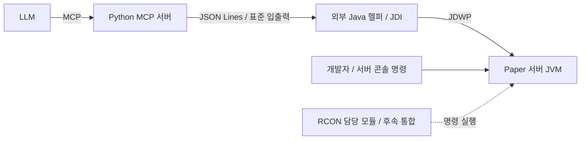

# JVM 디버거 개발 계획

수정일: 2026-10-13  
상태: JDI 기반 외부 Java 헬퍼를 개발 방식으로 선정. 구현 및 실제 서버 검증 전.

[전체 프로젝트 계획](project-plan.md)의 디버거 작업을 구체화한다. 기준 환경은 Windows, Java 17, Paper 1.20.1 build 196, Python MCP다. 버전은 기존 프로젝트 기준을 유지하며, 아래 도구와 경로는 개발 제안이다.

두 사람이 동시에 구현할 때는 [2인 병렬 개발 분업안](debugger-work-split.md)과 [Java·Python 통신 계약 v1](debugger-protocol.md)을 함께 읽는다. 분업안에는 담당 파일, 독립 시험 방법, 통합 기준과 에이전트별 작업 지시가 있다.

## 1. 이번에 개발할 범위

**RCON 담당 팀원의 구현을 기다리지 않고 디버거를 독립적으로 개발한다. 백엔드는 JDI 기반 외부 Java 헬퍼로 선정한다.**

| 이번 디버거 개발 | 후속 공동 통합 |
|---|---|
| JVM 연결, 중단점 등록·제거 | RCON 명령 작업과 중단 이벤트 연결 |
| 호출 스택, 인자·지역 변수·객체 필드 조회 | RCON 응답 대기 중 디버거 조회·재개 |
| 실행 재개, 연결 종료, 이벤트·증거 저장 | 명령 응답과 최종 게임 상태 대조 |
| Python 연동과 MCP 도구 제공 | 수정·재배포 후 실제 게임 결과 검증 |
| 단독 Java 샘플과 수동 콘솔 명령으로 검증 | 자동 테스트·빌드·배포 흐름 연결 |

독립 개발의 완료 기준은 **수동 서버 콘솔 명령 → 플러그인 중단점 → 스택·변수 조회 → 실행 재개 → 콘솔 명령 정상 종료**다. RCON 연결과 자동 게임 상태 검증은 이 단계의 완료 조건에 넣지 않는다.

## 2. RCON으로 실행한 동작의 결과도 확인할 수 있는가?

**가능하다. 명령 전달 방식과 관계없이, 연결한 JVM 안에서 조사 대상 플러그인 코드가 실행되고 중단점에 도달하면 내부 상태를 읽을 수 있다.** 다만 “결과”의 종류를 구분해야 한다.

| 알고 싶은 결과 | 확인 방법 | 담당 범위 |
|---|---|---|
| 어떤 코드가 실행되었는가 | 중단 위치와 호출 스택 | 디버거 MVP |
| 입력·선택 대상·계산값 | 인자, 지역 변수, 객체 필드 조회 | 디버거 MVP |
| 연산을 수행한 뒤의 값 | 대입·변경 이후 실행 가능한 줄에서 중단 | 디버거 MVP |
| Java 메서드 반환값 | 반환값을 담은 호출자 변수 조회, 또는 메서드 종료 이벤트 | 변수 조회는 MVP, 종료 이벤트는 후속 |
| RCON 응답 문자열 | RCON 클라이언트가 응답 원문 수집 | RCON 팀 |
| 게임에 최종 반영된 결과 | 재개 후 상태 조회·진단 출력과 비교 | 후속 통합 |

예를 들어 피해량 계산 결과를 `damage`에 대입했다면 **대입이 끝난 다음 줄**에서 `damage`를 확인한다. 대입문 자체에 멈추면 아직 계산이 실행되지 않았을 수 있다. JDI의 최상위 프레임 위치는 다음 실행할 명령을 가리킨다. [Java 17 StackFrame](https://docs.oracle.com/en/java/javase/17/docs/api/jdk.jdi/com/sun/jdi/StackFrame.html)

`damage = 10`은 계산 결과의 증거다. 몬스터 체력이 실제로 10 감소했다는 판정에는 피해 적용 이후의 상태가 필요하다. 이벤트 취소나 다른 플러그인의 개입이 있을 수 있으므로 계산값만으로 게임 결과를 확정하지 않는다. 객체 필드를 읽을 수 있어도 Minecraft 내부 필드에 의존하는 범용 게임 상태 조회는 이번 범위에 넣지 않는다.

메서드 종료 이벤트의 `returnValue()`는 대상 JVM의 지원 여부를 확인해야 한다. 예외로 종료된 메서드는 정상 종료 이벤트를 발생시키지 않으며, 반환값을 모든 기능의 성공 여부로 해석할 수는 없다. [Java 17 MethodExitEvent](https://docs.oracle.com/en/java/javase/17/docs/api/jdk.jdi/com/sun/jdi/event/MethodExitEvent.html)

이미 끝난 호출의 지역 변수나 과거 실행 전체를 디버거가 복원해 주지는 않는다. 조사 전에 중단점을 설정하고 재현한다. 비동기 작업은 해당 작업 코드에 별도 중단점이 필요하며, 관찰한 값은 재개 전에 저장한다.

## 3. DAP와 JDI의 차이 및 선정 이유

DAP는 도구와 디버그 어댑터가 대화하는 **통신 규약**이고, JDI는 Java 프로그램이 JVM을 디버깅하는 **API**다. 같은 계층의 대안은 아니다. Java DAP 어댑터가 내부에서 JDI를 사용할 수 있으며 Microsoft Java Debug도 이 구조다. 이번 선택은 **기존 DAP 어댑터를 연결할지, JDI로 필요한 기능만 감쌀지**다. [DAP 개요](https://microsoft.github.io/debug-adapter-protocol/overview.html), [Microsoft Java Debug](https://github.com/microsoft/java-debug)

| 비교 기준 | 기존 Java DAP 어댑터 재사용 | JDI 기반 작은 Java 헬퍼 |
|---|---|---|
| 개발 방식 | 기존 디버거 기능 재사용, Python에서 DAP 클라이언트 구현 | Java에서 JDI 호출 구현, Python에서 작은 요청 계약 사용 |
| 실행 환경 | 어댑터별 의존성 필요. Microsoft 공식 경로는 JDT Language Server 연동 | `jdk.jdi`가 포함된 JDK와 헬퍼 JAR, IDE·언어 서버 불필요 |
| 직접 관리할 부분 | 어댑터 시작·초기화, 프로토콜, 프로젝트 모델, 버전 조합 | 이벤트 루프, 중단점 위치, 참조 수명, 재개·종료 처리 |
| 현재 요구에 대한 적합성 | 풍부한 IDE 기능이 필요하면 유리 | attach·중단점·스택·변수·재개로 제한한 범위에 적합 |
| 향후 확장 | 여러 언어·IDE 연동과 고급 디버깅에 유리 | Java 전용의 제한된 도구를 유지하기에 적합 |

**선정: JDI 기반 외부 Java 헬퍼.** Java 전용 도구를 RCON과 독립적으로 개발하고, IDE·언어 서버 설치 없이 로컬에서 실행하는 구성을 우선한다. JDI는 JDK에서 중단점, 실행 제어, 스택·변수 조회 API를 제공한다. [Java 17 jdk.jdi](https://docs.oracle.com/en/java/javase/17/docs/api/jdk.jdi/module-summary.html)

이는 현재 요구와 확인한 의존성에 따른 설계 판단이다. JDI가 모든 프로젝트에서 개발이 더 쉽거나 오류가 없다는 뜻은 아니다. 이벤트 처리와 세션 관리를 직접 구현하는 비용은 남는다. MVP 범위를 제한하고 실제 Paper에서 접속·조회·재개를 먼저 검증한다. 이번 단계에서는 DAP 후보 비교 구현을 하지 않는다.

## 4. 연결 구조와 개발 산출물



디버거 헬퍼는 게임 밖에서 실행한다. 디버거 연결 때문에 Minecraft의 `plugins/`에 브리지 플러그인을 설치할 필요는 없다. 테스트 재현을 위한 샘플 플러그인은 별도로 만든다. JVM은 JDWP로 접속을 받고 Java 헬퍼는 JDI의 접속 API를 사용한다. [Oracle Java 17 JPDA](https://docs.oracle.com/en/java/javase/17/docs/specs/jpda/conninv.html)

Python이 헬퍼를 자식 프로세스로 시작하고 UTF-8 JSON Lines로 요청·응답·이벤트를 주고받는다. 요청마다 ID를 부여하고 응답과 이벤트를 구분한다. 헬퍼 stdout은 통신 전용, stderr는 로그 전용이다. Python MCP의 stdout도 MCP 전용으로 유지한다.

| 제안 경로 | 역할 |
|---|---|
| `debugger_helper/` | Java 17·Gradle 기반 헬퍼, JDI 연결과 이벤트 처리 |
| `mcp_server/adapters/debugger/` | 헬퍼 실행·종료, 요청 응답 연결, 이벤트 수신 |
| `mcp_server/tools/debugger.py` | 디버거 기능을 MCP 도구로 노출 |
| `tests/fixtures/java_debuggee/` | 알려진 입력·결과를 가진 단독 Java 샘플 |
| `plugin_template/debugger_sample/` | 수동 콘솔 명령으로 재현 가능한 Paper 샘플 |

헬퍼 실행에는 `jdk.jdi` 모듈이 포함된 JDK 17을 기준으로 삼는다. JSON 직렬화 라이브러리를 사용한다면 버전을 고정하고 헬퍼 JAR에 배포한다. IDE나 언어 서버는 실행 의존성으로 추가하지 않는다.

## 5. 독립 개발 순서와 완료 기준

| 단계 | 작업 | 완료 증거 |
|---|---|---|
| D0. 단독 환경 | JDWP로 단독 Java 샘플 실행, 디버그 정보 포함 빌드 | 알려진 입력과 계산 결과 재현 |
| D1. JDI 헬퍼 | attach, 클래스·줄 중단점, 이벤트 수신, 스택·변수, 재개 | 계산 이후 값 조회, 정상 종료 |
| D2. Python·세션 | JSON Lines 연결, 중단 ID, 참조 수명, 오류·종료 처리 | 중단 중에도 요청 가능, 오래된 참조 거절 |
| D3. MCP 도구 | 최소 도구 등록, 객체 조회 한도, 증거 저장 | 실제 MCP 호스트에서 조사 흐름 완료 |
| D4. Paper 검증 | 샘플 플러그인 설치, 서버 콘솔에서 수동 명령 실행 | 실제 플러그인 스택·변수 확인, 재개 후 명령 종료 |

D0~D4에서 RCON 접속 코드, 응답 파서, 작업 실행기를 구현하지 않는다. 테스트 입력은 단독 샘플과 서버 콘솔로 제공한다. 샘플 명령은 입력·계산 결과를 명시적으로 남겨 관찰한 값과 대조할 수 있게 한다.

서버 실행 옵션 예시:

```text
java -Xms1G -Xmx2G -agentlib:jdwp=transport=dt_socket,server=y,suspend=n,address=127.0.0.1:5005 -jar paper.jar --nogui
```

현재 실행 스크립트는 JDWP 옵션을 포함하지 않는다. 구현 시 별도 개발 실행 프로필을 추가한다. `suspend=n`은 디버거 연결 전에도 서버를 실행하며, 시작 초기 조사에 필요한 `suspend=y`는 별도 설정으로 둔다. [Oracle JDWP 옵션](https://docs.oracle.com/en/java/javase/17/docs/specs/jpda/conninv.html)

## 6. 최소 MCP 도구

| 도구 | 입력 | 주요 결과 |
|---|---|---|
| `attach_debugger` | 등록된 runtime_id, project_id | session_id, 연결 상태, 기능 목록 |
| `set_breakpoint` | session_id, class_name, line, 선택적 source_path | breakpoint_id, pending/verified/rejected, 실제 위치 |
| `remove_breakpoint` | session_id, breakpoint_id | 제거 확인 |
| `get_debug_state` | session_id | 연결 상태, 활성 중단, 이벤트 커서 |
| `get_stack_trace` | session_id, stop_id, thread_id, 페이지 | frame_id, 클래스·메서드·파일·줄 |
| `get_variables` | session_id, stop_id, frame_id 또는 object_ref, 페이지 | 값·타입·하위 참조·잘림 여부 |
| `resume_execution` | session_id, stop_id | 재개 확인, 무효화한 중단 ID |
| `detach_debugger` | session_id | 중단 정리·연결 종료 결과 |

초기 중단점은 완전한 클래스명과 줄 번호로 지정한다. 소스 경로는 등록된 프로젝트 안에서 검증하며, 클래스명에서 소스 경로를 자동 추론하는 기능은 후속으로 둔다. IDE 수준의 프로젝트 인덱싱을 구현하지 않는다.

미로딩 클래스는 `pending`으로 등록하고 클래스 준비 이벤트 때 중단점을 적용한다. 실행 가능한 줄이 없으면 거절하며 임의로 다른 줄을 선택하지 않는다. 같은 클래스명이 여러 클래스 로더에 있으면 모호성을 보고하고 로더를 명시하도록 한다. 단일 로더의 샘플로 먼저 검증한다.

step, 예외 중단점, 메서드 반환 이벤트, 조건부 중단점, hot swap은 후속이다. 임의 표현식 평가·메서드 호출·변수 변경도 MVP에서 제외한다. 객체 표시를 위해 `toString()`이나 getter를 자동 호출하지 않고 필드와 기본 값만 읽는다.

## 7. 세션과 안정적인 실행

연결 상태와 스레드 중단 상태를 분리한다. 연결 상태는 `disconnected → connecting → connected → disconnected/terminated`로 기록한다. 중단마다 `stop_id`, `thread_id`, 원인, 실제 suspend policy, 시각을 기록한다.

프레임·객체 도구 참조는 `(session_id, stop_id, reference_id)`에 속한다. 재개·detach·재연결·JVM 재시작 뒤 무효화한다. JDI의 스택 프레임도 해당 스레드가 재개되면 유효하지 않다. [Java 17 StackFrame](https://docs.oracle.com/en/java/javase/17/docs/api/jdk.jdi/com/sun/jdi/StackFrame.html)

- 실행 제어를 직렬화하고 활성 중단 하나를 조사한다. 추가 이벤트는 기록 후 자신이 보유한 이벤트 중단을 정리한다.
- 독립 이벤트 수신 루프를 유지한다. 에이전트는 `get_debug_state`로 조회하며 이벤트가 LLM을 자동 실행한다고 가정하지 않는다.
- 지역 변수 정보가 없으면 `debug_info_missing`을 반환한다. 인자·필드 등 대체 조회 범위를 설명한다.
- 객체 조회는 깊이·항목 수·문자 수를 제한하고 페이지와 순환 참조를 처리한다.
- 수동 배포에서도 소스 리비전과 JAR 해시를 기록한다. 실행 JAR와 연결할 근거가 없으면 소스 일치를 `unverified`로 표시한다.
- 중단된 동안 수집한 값을 저장하고, 연결 단절 뒤 이전 값을 현재 상태로 반환하지 않는다.

기본 정책은 이벤트 스레드만 중단하는 방식으로 검증한다. 다른 스레드 값까지 동일 시점의 일관된 스냅샷이라고 표현하지 않는다. [Java 17 EventRequest](https://docs.oracle.com/en/java/javase/17/docs/api/jdk.jdi/com/sun/jdi/request/EventRequest.html)

주 스레드 중단은 틱과 콘솔 명령 진행을 막을 수 있으므로 수동 시험에서도 watchdog 설정과 중단 시간을 확인한다. [Paper 디버깅 안내](https://docs.papermc.io/paper/dev/debugging/)

헬퍼에 중단 기한을 두고 만료 시 보유한 이벤트 중단을 재개한다. 자동 재개 이유를 기록하고 이전 참조를 무효화한다. Python 연결 종료 시에도 정리하며 헬퍼 강제 종료 시 JVM 동작은 통합 시험으로 확인한다. 재개 실패는 성공으로 처리하지 않는다.

증거에는 로컬 run_id, 런타임 부팅 ID, session_id, stop_id, 소스 리비전·JAR 해시, Java·서버·헬퍼 버전, UTC 시각, 중단 위치와 조회한 값을 남긴다. RCON job_id와 응답은 후속 통합에서 추가한다. 오류는 `attach_failed`, `breakpoint_unresolved`, `debug_info_missing`, `not_suspended`, `stale_reference`, `vm_disconnected`, `resume_failed` 등으로 구분한다.

## 8. 후속 RCON 통합 시 맞출 계약

이 절은 향후 팀 간 연결 기준이며 디버거 단독 완료 조건이 아니다.

| RCON 담당 모듈이 제공할 정보·동작 | 디버거 담당 모듈이 제공할 정보·동작 |
|---|---|
| 명령 실행 job_id, 원문 응답, 진행·timeout 상태 | session_id, stop_id, 중단 위치·스레드·시각 |
| 응답을 기다려도 다른 도구 호출을 막지 않는 실행 방식 | 독립 이벤트 수신, 스택·변수 조회, 재개 |
| 가능한 경우 명령·로그에 test run_id 전달 | 중단 증거에 관련 run_id를 연결할 인터페이스 |
| 재개 이후 게임 상태 조회 | 중단 중 수집한 계산값·선택 대상 증거 |

수동 콘솔 입력을 RCON 명령 작업으로 바꿔 동일 조사 흐름을 반복한다. 명령 처리 중 중단되면 RCON 응답도 대기할 수 있다. RCON 네트워크 timeout을 명령 미실행으로 해석하거나 변경 명령을 자동 재전송하지 않는다.

시간상 가까운 중단을 특정 명령의 결과로 확정하지 않는다. run_id가 테스트 코드까지 전달되어 확인되는 경우에만 직접 연결하고, 그렇지 않으면 관련 후보로 표시한다. 최종 기능 검증은 중단점 없이 같은 초기 조건에서 다시 실행한다.

## 9. 독립 검증 체크리스트

- [ ] RCON을 끈 환경에서도 단독 Java 샘플과 Paper 플러그인 디버깅이 완료된다.
- [ ] 계산 이후 중단점에서 알려진 결과값·인자·필드·스택을 읽는다.
- [ ] 클래스 로딩 전 중단점이 로딩 후 적용된다.
- [ ] 없는 실행 줄, 디버그 정보 누락, 소스 일치 미확인을 구분한다.
- [ ] 재개 이후 이전 프레임·객체 참조를 거절한다.
- [ ] 중단 중 MCP 상태·변수 조회와 재개가 가능하다.
- [ ] 중단 기한 만료와 정상 detach 이후 서버가 계속 실행된다.
- [ ] Python 종료, 헬퍼 종료, JVM 종료·재시작 후 상태를 갱신한다.
- [ ] 실제 MCP 호스트에서 수동 콘솔 명령을 조사하고 정상 종료까지 확인한다.

병렬 개발에서는 A가 **D0 단독 샘플 → D1 JDI 헬퍼**, B가 **모의 헬퍼 → D2 Python·D3 MCP**를 동시에 진행한다. 최소 접속 흐름부터 실제 헬퍼를 연결하고 D4 Paper 수동 검증을 함께 완료한다. 담당 파일과 통신 경계는 [분업안](debugger-work-split.md)을 따른다.
