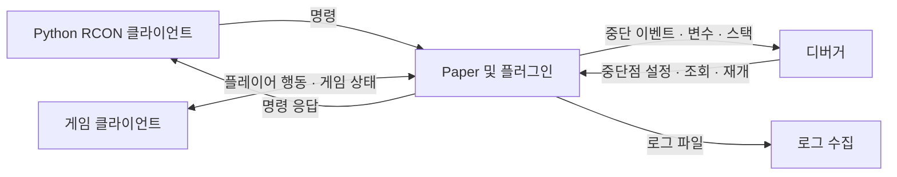

# RCON 이해와 팀 연결 실험 계획

작성일: 2026-10-13

상태: 개념 정리 및 실험 계획. 이 문서의 테스트 명령과 응답 형식은 제안이며, 아직 구현하거나 실제 서버에서 검증하지 않았다.

팀 구성: 전체 4명. RCON팀 2명과 debugger팀 2명이 각각 연결을 검증한 뒤 하나의 시나리오로 통합한다. 전체 방향은 [프로젝트 계획](project-plan.md)을 따른다.

## 1. RCON은 콘솔과 로그를 Python에서 접근하게 해주는 방식인가?

정확히는 **서버 콘솔 명령을 외부 프로그램에서 실행하고, 그 명령에 대한 응답 문자열을 받는 통신 방식**이다. RCON은 Remote Console의 약자다. Python 전용 기능은 아니며, 우리는 Python 클라이언트를 사용할 예정이다.

다음 둘은 구분해야 한다.

| 종류 | 예시 | 수집 방법 |
|---|---|---|
| 명령 응답 | `list`를 실행한 뒤 받은 접속자 목록 | RCON |
| 서버 로그 | 플러그인 로딩, 예외 스택, 다른 시점의 이벤트 기록 | 로그 파일 또는 서버 프로세스 출력 수집 |

RCON은 서버 콘솔 창 전체를 그대로 보여주는 기능이 아니다. 명령과 관계없이 발생하는 로그를 계속 구독하는 기능도 아니다. 플러그인이 logger에 기록한 내용을 RCON 응답으로 자동 수집할 수 있다고 가정하면 안 된다.

Paper에서는 `enable-rcon`, `rcon.port`, `rcon.password`로 RCON을 설정한다. [Paper 서버 설정](https://docs.papermc.io/paper/reference/server-properties/)

연결 흐름은 다음과 같다.

```text
Python → TCP 연결 → 비밀번호 인증 → 서버 명령 전송
       ← 명령 실행에 대한 텍스트 응답 ← Minecraft/Paper
```

패킷의 길이, 요청 ID, 종류, 본문을 처리하는 작업은 RCON 라이브러리가 담당한다. 요청 ID는 통신을 구분하기 위한 값이며, 플러그인의 작업 완료나 중복 실행 방지를 보장하는 번호가 아니다. [클라이언트 구현 예시](https://github.com/Uncaught-Exceptions/MCRcon/blob/master/mcrcon.py)

## 2. Minecraft 명령어를 쓸 수 있다는 점이 장점인가?

그렇다. Minecraft/Paper가 이미 제공하는 명령 처리 기능을 외부 자동화에서 활용할 수 있다는 것이 장점이다.

- 접속자나 명령으로 노출된 상태를 조회한다.
- 테스트에 필요한 시간, 블록, 엔티티 등 초기 조건을 만든다.
- 같은 명령을 반복 실행해 버그를 재현한다.
- 수정 후 같은 조건으로 다시 실행해 결과를 비교한다.

Minecraft/Paper의 기본 명령에 연결하기 위해 별도의 게임 브리지 플러그인을 먼저 만들 필요는 없다. 다만 명령으로 노출되지 않은 상태까지 RCON이 자동으로 조회해 주지는 않는다.

RCON은 Java 메서드를 이름으로 직접 호출하는 기능도 아니다. 외부에서 실행할 동작이 명령으로 등록되어 있어야 한다.

## 3. 플러그인에서 만든 명령도 실행할 수 있는가?

**서버에 등록되어 있고 RCON 실행자를 지원하는 플러그인 명령이라면 실행할 수 있다.**

예를 들어 우리가 다음 명령을 구현했다고 가정한다.

```text
crafttest add 2 3
```

처리 흐름은 다음과 같다.

```text
Python의 command("crafttest add 2 3")
→ Paper의 명령 처리
→ 플러그인의 명령 처리 함수
→ 덧셈 로직 실행
→ 실행자에게 결과 메시지 전달
→ Python에서 응답 수신
```

이 구조를 이용하면 매번 게임 채팅창에서 명령을 입력하지 않아도 플러그인 동작을 재현할 수 있다. Bukkit 방식의 명령 처리 함수는 `CommandSender sender`와 인자를 받는다. 실행자에게 보낼 응답과 서버 로그는 구분해서 작성한다. [CommandExecutor API](https://hub.spigotmc.org/javadocs/bukkit/org/bukkit/command/CommandExecutor.html)

플러그인 개발에서 얻는 효과는 다음과 같다.

| 목적 | 예시 | 확인할 결과 |
|---|---|---|
| 기능 재현 | 계산 테스트 명령 실행 | 입력에 맞는 결과 |
| 상태 변경 | 특정 플레이어에게 테스트 보상 지급 | 인벤토리의 실제 수량 변화 |
| 원인 조사 | 동일 명령을 디버거 연결 상태에서 실행 | 중단점의 인자와 분기 |
| 회귀 확인 | 수정 전후 같은 명령 실행 | 실패했던 조건이 통과하는지 |

진단용 명령을 추가하더라도 테스트 전용 가짜 로직만 검증하지 않도록 한다. 실제 기능과 공통 서비스 로직을 호출하고, 입력 경로가 다른 부분은 별도 테스트로 남긴다.

## 4. RCON 명령의 실행 주체는 누구인가?

Python은 명령을 보내는 클라이언트다. 서버의 플러그인이 보는 실행자는 **원격 콘솔 실행자**다. Bukkit/Paper API에서는 `RemoteConsoleCommandSender`로 표현되며 `CommandSender`를 확장한다. 게임에 접속한 `Player`가 아니다. [RemoteConsoleCommandSender API](https://hub.spigotmc.org/javadocs/bukkit/org/bukkit/command/RemoteConsoleCommandSender.html)

여기서 실행자와 대상은 다르다.

```text
명령: give Alice minecraft:stone 1

실행자: RCON 원격 콘솔
대상: 서버에 접속한 Alice
효과: Alice에게 돌 1개 지급
```

Alice에게 영향을 주는 명령이라고 해서 Alice가 명령을 실행한 것이 되지는 않는다. RCON 인증도 Minecraft 플레이어 로그인과 별개다.

플러그인에서 아래처럼 실행자를 제한하면 RCON 호출은 거절된다.

```java
if (!(sender instanceof Player)) {
    sender.sendMessage("플레이어만 실행할 수 있습니다.");
    return true;
}
```

RCON에서 사용할 테스트 명령은 실행자에게 위치나 인벤토리가 있다고 가정하지 않아야 한다. 필요한 플레이어, 월드, 좌표는 명시적인 인자로 받고 유효성을 검사한다. 권한 검사 역시 플레이어 실행과 별도로 확인한다.

## 5. 플레이어 대상 명령은 테스트하기 어려운가?

대상이 플레이어라는 사실보다 **플레이어가 직접 실행하거나 행동해야 하는 기능인지**가 중요하다.

| 종류 | 예시 | 첫 테스트 방법과 한계 |
|---|---|---|
| 플레이어를 대상으로 하는 명령 | Alice에게 아이템 지급 | RCON으로 실행하고 Alice의 상태 확인 |
| 실행자 자신을 대상으로 하는 명령 | `/heal`로 자기 자신 회복 | 콘솔용 대상 인자를 지원하거나 플레이어가 직접 실행 |
| 플레이어 행동으로 발생하는 기능 | 우클릭 스킬, 이동 이벤트 | 사람 또는 테스트 클라이언트로 행동 재현 |
| 화면에서 확인해야 하는 기능 | GUI, HUD, 시각 효과 | 실제 클라이언트 관찰 필요 |

예를 들어 `/heal`이 실행자를 `Player`로 가정한다면 RCON에서 그대로 사용할 수 없다. 플러그인에 `heal <player>` 같은 콘솔용 경로를 설계할 수 있지만, 이 테스트만으로 플레이어 채팅 입력, 플레이어 권한, 클릭 이벤트까지 검증했다고 말할 수는 없다.

`execute as` 같은 명령으로 실행 문맥을 바꿀 수 있는 경우도 있으나, 모든 플러그인이 이를 실제 `Player` 실행과 동일하게 처리한다고 가정하지 않는다. 대상 플러그인에서 별도로 확인해야 한다.

## 6. RCON은 응답을 정확히 확인하기 어려운가?

앞선 설명은 더 정확하게 구분할 필요가 있다. **RCON은 응답을 받을 수 있다. 다만 응답 수신과 기능 성공은 서로 다른 판정이다.**

| 단계 | 확인하는 내용 | 아직 보장하지 않는 것 |
|---|---|---|
| 연결·인증 성공 | 서버와 통신할 수 있음 | 명령 실행 성공 |
| 응답 수신 | 명령에 대한 문자열을 받음 | 문자열이 성공을 의미하는지 |
| 명령 결과 확인 | 플러그인이 보고한 결과 | 실제 게임 상태가 기대대로 바뀌었는지 |
| 상태 검증 | 대상의 상태 변화 확인 | 화면이나 실제 입력 경로까지 정상인지 |

예를 들어 `Unknown command`도 수신에 성공한 응답이다. `작업을 시작했습니다`라는 응답은 비동기 작업 완료를 뜻하지 않는다. 응답이 비어 있어도 그 사실만으로 성공이나 실패를 단정할 수 없다.

우리 테스트 명령에는 해석하기 쉬운 응답 규칙을 정한다. 아래는 제안이며 RCON 자체의 표준이 아니다.

```text
CRAFTTEST status=ok operation=add result=5
CRAFTTEST status=error code=PLAYER_NOT_FOUND target=Alice
```

오래 걸리는 작업은 작업 ID를 반환하고 별도 조회 명령으로 완료 상태를 확인하는 방식을 검토한다. 지급 같은 변경 명령의 응답을 잃어버렸다면 실행 여부를 먼저 조사한다. 자동 재전송하면 중복 실행될 수 있다.

긴 응답의 분할 수신, 한글 처리, 연결 종료, 제한 시간도 라이브러리 검증 항목이다. 단순한 `list` 성공만으로 통신의 모든 조건을 검증한 것은 아니다.

## 7. RCON이 input이고 debugger가 output인가?

두 도구 모두 입력과 출력이 있다. 다음처럼 역할을 나누는 편이 정확하다.

| 도구 | 보내는 것 | 받거나 관찰하는 것 |
|---|---|---|
| RCON | 서버 명령 | 명령 응답, 명령으로 조회한 상태 |
| debugger | 중단점, 변수 조회, 실행 재개 요청 | 멈춘 위치, 변수, 호출 스택 |
| 로그 수집 | 파일·시점 등 조회 조건 | 기록된 로그와 예외 |
| 게임 클라이언트 | 플레이어 행동 | 화면과 플레이어 관점의 결과 |

RCON은 기능을 실행하고 결과를 조회하는 통로다. 디버거는 그 기능이 **왜 그런 결과를 냈는지 코드 내부를 조사하는 통로**다. 디버거에서는 중단점으로 실행을 멈추고 변수나 실행 흐름을 살펴볼 수 있다. [Paper 디버깅 안내](https://docs.papermc.io/paper/dev/debugging/)



계산 결과 변수가 `5`라는 사실과, 게임에서 올바른 대상에게 보상이 지급되었다는 사실도 구분한다. 디버거 관찰 후에는 정상 실행 상태에서 실제 결과를 다시 검증한다.

## 8. 두 팀의 첫 실험 계획

### 8.1 공통으로 정할 것

- 서버·Java·샘플 플러그인 버전을 맞춘다. 현재 저장소 기준은 Paper 1.20.1, Java 17이며 실제 실행 가능 여부는 확인이 필요하다.
- 첫 공통 명령은 플레이어 접속 없이 실행할 수 있는 `crafttest add 2 3`으로 제안한다.
- 샘플 플러그인 담당 1명을 정한다. RCON팀이 명령·응답 규칙을, debugger팀이 중단점 위치와 소스/JAR 일치를 함께 확인한다.
- 처음에는 팀별 로컬 서버에서 독립 실험하고, 통합 때 동일한 서버 인스턴스를 사용한다.

### 8.2 RCON팀 2명의 역할 제안

| 담당 | 작업 | 완료 증거 |
|---|---|---|
| 서버·명령 담당 | 설정, 서버 실행, 샘플 명령 등록, 콘솔/RCON 실행 지원 | 서버에서 로드된 플러그인과 명령 결과 |
| Python·검증 담당 | 인증, 명령 송수신, 실패 분류, 응답 기록 | 반복 실행 가능한 클라이언트와 테스트 기록 |

첫 실험은 MCP 없이 Python에서 직접 연결한다. 연결과 실패 처리를 확인한 뒤 같은 기능을 MCP 도구로 노출한다. RCON 라이브러리는 아직 최종 선정하지 않는다.

### 8.3 단계별 완료 기준

| 단계 | 실험 | 통과 기준 |
|---|---|---|
| 1 | RCON 인증 후 `list` | 실제 서버의 응답 수신 |
| 2 | 잘못된 비밀번호, 서버 종료, 없는 명령 | 인증·연결·명령 오류를 구분 |
| 3 | `crafttest add 2 3` | 약속한 형식으로 결과 `5` 수신 |
| 4 | 서버 무응답, 연결 단절, 긴 응답 | 제한 시간 내 종료하고 유실·잘림 여부 기록 |
| 5 | debugger와 통합 | 명령 처리 중단점에서 인자 확인 → 재개 → RCON 결과 수신 |
| 6 | 플레이어 대상 기능 | 사전에 정한 대상 상태의 변경 전후를 확인 |

각 기록에는 서버·플러그인 버전, 실행 명령, 기대 결과, 실제 응답, 경과 시간, 판정을 남긴다. 비밀번호는 기록하지 않는다.

### 8.4 통합할 때 주의할 점

중단점에서 서버 실행이 멈추면 RCON 명령 응답도 지연될 수 있다. RCON 응답을 기다리는 동안 디버거의 변수 조회와 재개 요청을 처리할 수 있어야 한다.

두 팀은 중단 상태와 실제 통신 장애를 구분하는 방법, 대기 제한 시간, 재개 후 응답 수신을 함께 시험한다. 중단으로 watchdog이나 클라이언트 timeout이 발생할 가능성도 별도 개발 환경에서 확인한다. 최신 문서의 실행 옵션을 현재 서버 버전에 검증 없이 적용하지 않는다. [Paper 디버깅 안내](https://docs.papermc.io/paper/dev/debugging/)

## 9. 실행 준비 시 확인할 저장소 상태

- `mc_server/server.properties.example`에는 RCON 활성화 설정이 있지만 비밀번호가 비어 있다. 실제 `server.properties` 설정이 필요하다.
- `mc_server/start.bat`는 같은 폴더의 `paper.jar`를 실행한다. 실제 JAR 이름과 일치시켜야 한다.
- `.env.example`의 `RCON_PASSWORD`는 예시다. 현재 실행 스크립트는 이를 서버 설정에 자동 반영하지 않는다.
- 기본 RCON 통신은 암호화되지 않으므로 첫 실험은 localhost로 제한하고 실제 리스닝 주소를 확인한다. 원격 팀 연결은 보호된 터널 등을 별도로 설계한다.
- 라이브러리는 Windows 제한 시간 처리까지 검증한다. 앞서 소개한 `mcrcon`의 확인된 소스는 Windows에서 읽기 타이머를 사용하지 않으므로 이름만 보고 timeout 지원을 가정하지 않는다. [소스 확인](https://github.com/Uncaught-Exceptions/MCRcon/blob/master/mcrcon.py)

이 문서 작성에서는 설정 변경, 의존성 설치, 서버 실행을 수행하지 않았다.

## 10. 참고 자료의 적용 범위

링크한 Paper 문서와 Spigot API 문서는 현재 공개 문서다. 개념과 API 역할의 근거로 사용했으며, 프로젝트 기준인 Paper 1.20.1에서의 구현·호환성은 실제 실험으로 확인한다. `crafttest` 명령, 응답 형식, 팀별 세부 역할은 이 프로젝트를 위한 제안이다.
